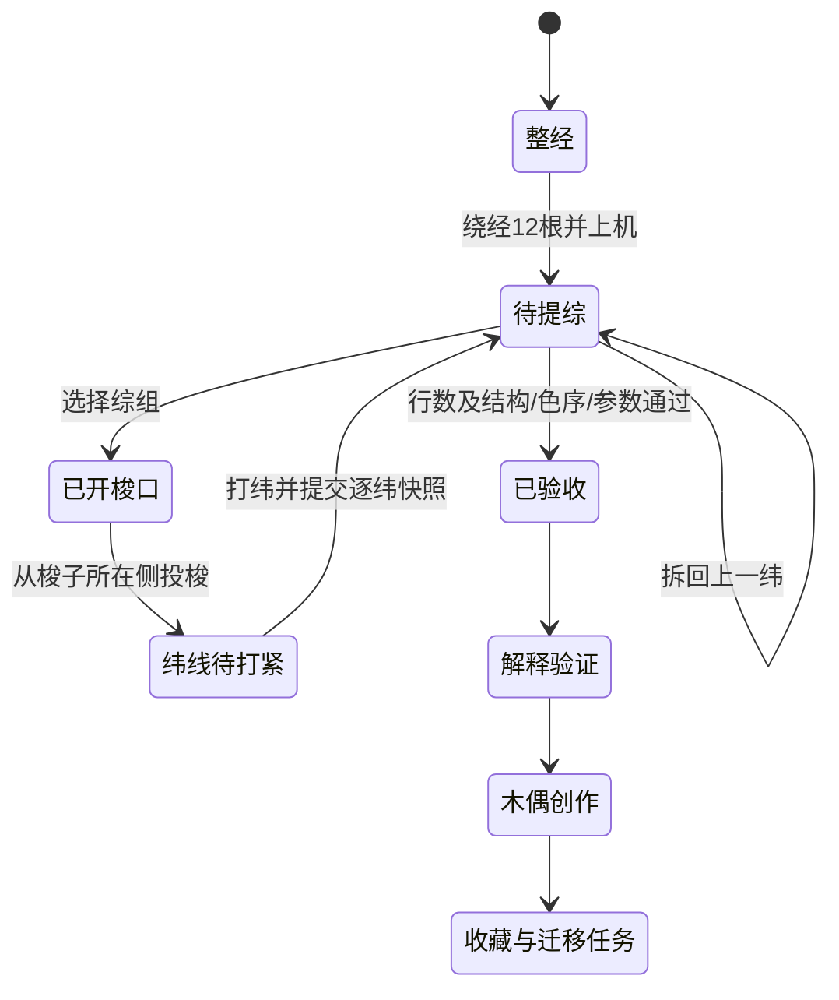

# 从工具拼接到可检查的工艺任务

## 产品中的连续性

用户接收的不是几组彼此无关的功能，而是一份需要交付的数字样布委托。资料解释工具，工具操作改变织物，织物中的缺陷引导用户读过程记录并修复；经解释验证后，样布成为木偶创作的实际材料。收藏保留经纬结构、逐纬参数、绘制位置、反思与操作过程。

## 工艺状态

每次合法操作生成事件。未提综不能投梭，梭子方向需要匹配所在侧，未投梭不能打纬。投梭时快照综组、浮沉掩码、纱线、张力；打纬时写入力度，提交到实际纬线数组。撤回待打纬的线与拆回已织纬线分别处理。验收后的样布不能再改写，创作台保留其原始制作过程。

上游 `warpFaceUp` 定义平纹/斜纹结构。评价独立比较每纬掩码与委托目标，因此不是按操作次数发放通关。生成的布面读取实际掩码、每纬颜色及密度，错误会显示在三维布、放大图和台账中。木偶材质读取同一份布面，不以预设贴图代替用户结果。

## 教学与可检查依据

| 环节 | 学习目标 | 可观察行为 |
| --- | --- | --- |
| 来源研读 | 区分纺染织绣与当前模型范围 | 研读资料及文化归属解释 |
| 引导平纹 | 理解经纬和交替关系 | 实际提综、投梭、打纬顺序与逐纬掩码 |
| 故障修复 | 从作品定位过程错误 | 拆回两纬并重织，原事件仍保留 |
| 独立迁移 | 在相位与色序变化后应用规律 | 隐藏逐步答案，按新条件完成8纬 |
| 四综斜纹 | 理解相位偏移与长浮线 | 4周期掩码形成2/2斜纹 |
| 创作 | 复用材料、解释设计边界 | 实际样布贴图、UV装饰与反思 |

提示次数与修复次数只用于描述过程，不直接等于能力分数。当前解释题是基础检验，并不能替代真实学习效果研究；作品的视觉审美不由模型评分。

## 模型与规则的边界

规则负责操作合法性、交织结构、颜色任务约束和教学参数范围。模型只读取结构状态、最近操作及有来源的课程文本，生成引导性讲解，不能调用修改作品的工具。界面通过 `textContent` 或转义输出回答。离线诊断不显示为模型回答。独立挑战在客户端和服务端均阻止逐步提示。

## 移动端工程

单个场景实例跨页面保留，交互只更新状态与必要纹理，不按每个操作重建 WebGL 上下文。画面上限约30fps，像素比上限1.65，影子图1024；后台暂停计时器和渲染，纹理更换时释放旧资源。模型或WebGL失败不阻塞工艺工具。

Android 通过 `WebViewAssetLoader` 加载 APK 内的 HTTPS 资产，禁用文件与内容访问，外部页面转浏览器。原生文件桥只接受 PNG/JSON，限制载荷大小，通过系统 `ACTION_CREATE_DOCUMENT` 让用户选路径，不接受任意磁盘路径。模型密钥不进入 APK；访问外部模型是可选 HTTPS 服务。

Android 验收包括 build、lint 和模拟器上的真实 WebView 启动/存档重载；浏览器覆盖完整四任务，不把浏览器测试等同于实体手机兼容性测试。
